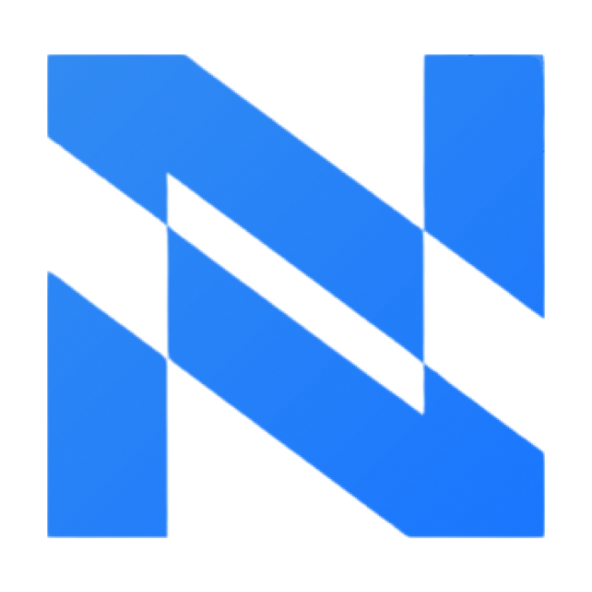
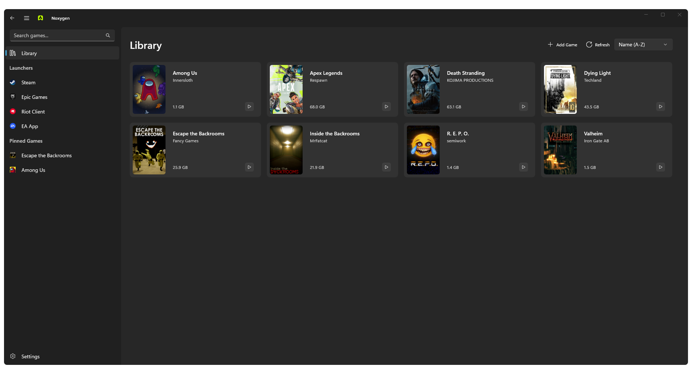

  
  <h1>
  Noxygen
  </h1>

  A lightweight, modern game launcher for Windows 11 built with <a href="https://learn.microsoft.com/en-us/windows/apps/winui/winui3/">WinUI 3</a> & <a href="https://learn.microsoft.com/en-us/windows/apps/windows-app-sdk/">Windows App SDK</a>

Noxygen combines your game libraries from different platforms into a single, cohesive interface designed with Fluent Design principles. Automatically detect installed titles across major storefronts or add custom executables with ease.

  

## ✨ Features

- **Unified Game Library:** Scans for games on **Steam**, **Epic Games**, and **GOG Galaxy**, while allowing you to add your own `.exe` games.
- **Launcher Quick-Access:** Finds your installed game clients (Steam, Epic Games, GOG Galaxy, etc.) and adds sidebar shortcuts for instant launching.
- **Taskbar Jump List:** Pin your favorite games or recent titles for quick access directly from the Windows Taskbar.

## 🚀 Installation

### 1. Download the Files
Visit the [Releases](https://github.com/hxdd7/Noxygen/releases) page and download:
- `Noxygen.cer`
- `Noxygen_1.x.x.x_x64.msix`

### 2. Install the Signing Certificate *(First Time Only)*
1. Double-click **`Noxygen.cer`** and select **Install Certificate...**.
2. Choose **Local Machine** and click **Next**.
3. Select **Trusted People** as the store and finish the installation.

### 3. Install Noxygen
1. Double-click **`Noxygen_1.x.x.x_x64.msix`**.
2. Click **Install** when prompted.
3. 
